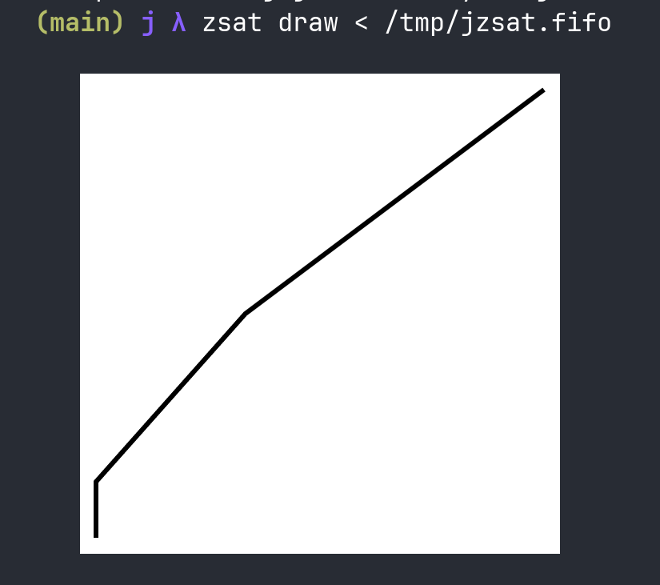

# zsat

## Contents
1. [What is zsat](#what-is-zsat)
2. [Workflow](#workflow)


### What is zsat

[zsat](https://github.com/paweljakubas/zsat) is a Zig-based science plotting and
animation command line tool. It consumes 2D vector data from **stdin** as text,
e.g. `[[0,1],[1,3],[2,4]]`, and renders it in any terminal that implements the
[kitty graphics protocol](https://sw.kovidgoyal.net/kitty/graphics-protocol/)
(supported in many modern terminals like Kitty, WezTerm, Ghostty, ...).

`j/analysis.ijs` ships a `vec2d` function that turns a two-row array into
zsat's `vec2d` JSON and hands it over to zsat through a named pipe (FIFO). This
makes it possible to drive zsat directly from an interactive `jconsole` session
running in one terminal, while zsat consumes the data from another.

`vec2d` takes a two-row array (`2 x n`) where each column becomes one `[x,y]`
pair:

```j
   vec2d 2 3 $ 0 1 2 1 3 4
[[0,1],[1,3],[2,4]]
```

The data is written to the FIFO named by the `JZSAT_FIFO` environment variable
(default `/tmp/jzsat.fifo`, created automatically) and is also returned as the
result.

## Workflow

1. In `jconsole` import `analysis.ijs` script. Thanks to that `vec2d` will be available for usage.

   ```j
   jconsole> ]scriptdir=: '/home/pawel/Work/j/j-data-analysis/j/'
   jconsole> 0!:1 < scriptdir,'analysis.ijs'
   ```

2. In `jconsole` invoke `vec2d`. J opens the FIFO forjconsol writing and blocks,
   waiting for a reader to attach:

   ```j
   jconsole> vec2d 2 3 $ 0 1 2 1 3 4
   ```

3. Switch to the terminal/pane where `zsat` runs and consume the stream. The
   reader attaches to the FIFO, the data flows, and zsat draws the figure:

   ```bash
   zsat draw < /tmp/jzsat.fifo
   ```
<div align="left">
  
  <p>What one should see in Ghostty terminal</p>
</div>


4. Switch back to `jconsole`, which has returned to the prompt and printed the
   data it sent:

   ```
   [[0,1],[1,3],[2,4]]
   ```

To use a different FIFO path, set `JZSAT_FIFO` before starting `jconsole`:

```bash
JZSAT_FIFO=/tmp/my.fifo jconsole
```

With that usage the consumer can use only FIFO stream only once.